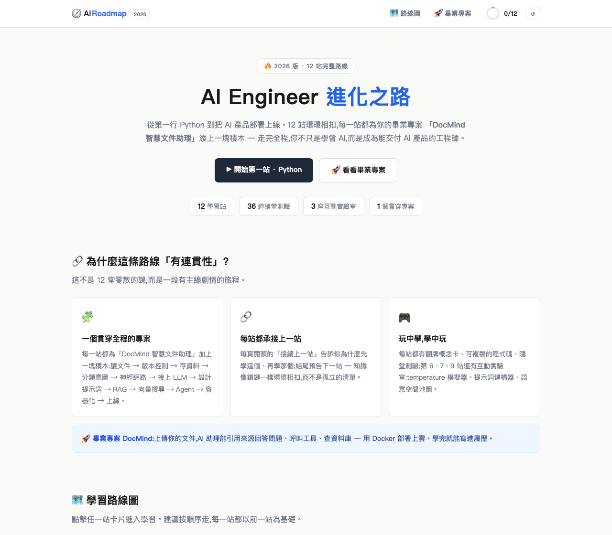
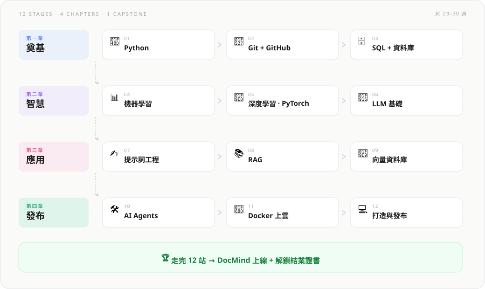
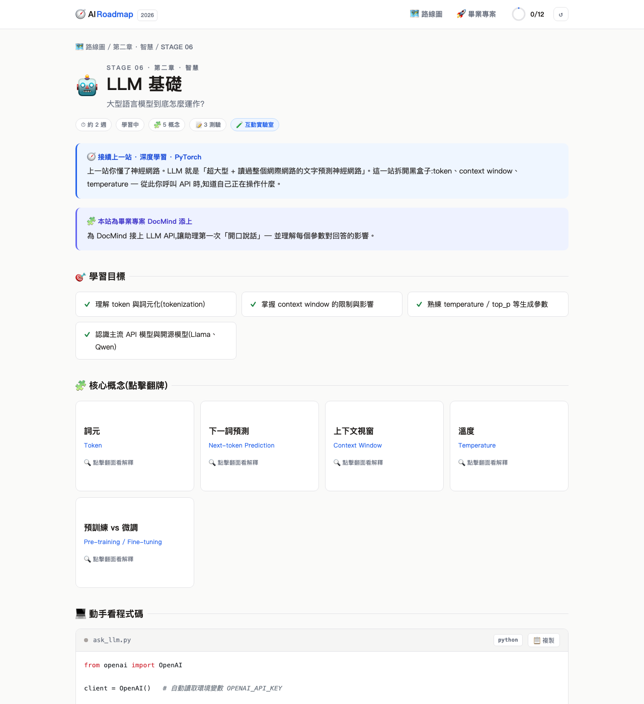
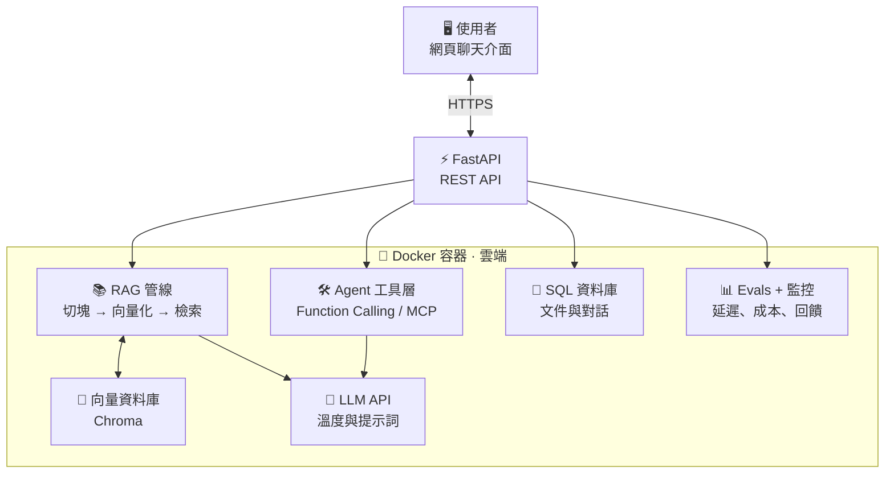
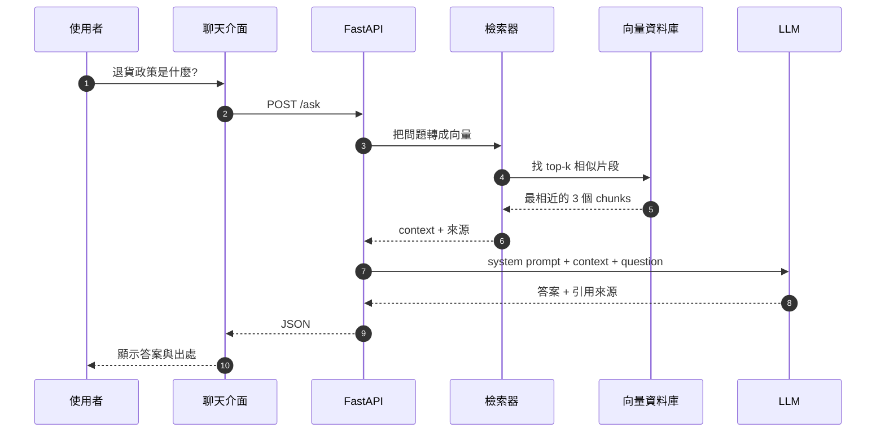

<div align="center">

# 🧭 AI Engineer Roadmap 2026

**12 站互動學習地圖:從第一行 Python,到一個真的能上線的 AI 產品。**

[🚀 線上開始](https://yu-0312.github.io/ai-engineer-roadmap/) ·
[🏆 畢業專案](https://yu-0312.github.io/ai-engineer-roadmap/#/capstone) ·
[🐛 回報問題](https://github.com/Yu-0312/ai-engineer-roadmap/issues)

[](https://yu-0312.github.io/ai-engineer-roadmap/)
[](https://github.com/Yu-0312/ai-engineer-roadmap/actions/workflows/link-check.yml)


<a href="https://yu-0312.github.io/ai-engineer-roadmap/">
  
</a>

</div>

這不是 12 篇零散教學,而是一條有主線劇情的路線:每一站都替畢業專案 **DocMind 智慧文件助理** 加一塊積木 — 讀文件 → Git → SQL → 意圖分類 → 神經網路 → 接 LLM → 提示詞 → RAG → 向量庫 → Agent → Docker → 上線。走完 12 站,你會得到一個能引用來源、呼叫工具、部署在雲端的 AI 產品,以及一張可以印出來的結業證書。

**純前端、零依賴、免建置。** 打開 `index.html` 就能用;學習進度只存在你的瀏覽器裡。

| 你的目標 | 從這裡開始 |
| --- | --- |
| 第一次來,想直接學 | [線上開始](https://yu-0312.github.io/ai-engineer-roadmap/#/stage/1) → 第 1 站 Python |
| 想在自己的電腦跑 | [快速開始](#快速開始) |
| 想改內容、加一站 | [內容資料格式](#內容資料格式) |

---

## 路線圖

四章、12 站,每一站都以前一站為基礎;最後一站把積木拼成產品。

<p align="center">
  
</p>

| 章 | 站 | 建議時間 |
| --- | :--: | --- |
| 第一章 · 奠基 | 1–3 | 5–6 週 |
| 第二章 · 智慧 | 4–6 | 9–12 週 |
| 第三章 · 應用 | 7–9 | 5–6 週 |
| 第四章 · 發布 | 10–12 | 4–6 週 + 持續進行 |

合計約 23–30 週。時長是站上標示的建議值,不是硬性期限;依自己的節奏走就好。

## 12 站與 DocMind 積木

每一站的「動手實作」都會直接變成 DocMind 的一個零件。

| # | 站 | 你會帶走 | DocMind 積木 |
| :--: | --- | --- | --- |
| 01 | 🐍 Python | 變數、容器、函式、venv、檔案與 JSON | 讀文件、清文字、統計字詞的資料管線雛形 |
| 02 | 🔧 Git + GitHub | add/commit/push、分支、PR、`.gitignore` | 專案 repo、README 與分支開發流程 |
| 03 | 🗄️ SQL + 資料庫 | 表設計、CRUD、JOIN、SQL vs NoSQL | `documents`、`chats`、`messages` 三張核心表 |
| 04 | 📊 機器學習 | 監督式學習、train/test、過擬合、scikit-learn | 判斷「摘要 / 翻譯 / 閒聊」的意圖分類器 |
| 05 | 🧠 深度學習 · PyTorch | Tensor、autograd、訓練迴圈、Transformer | 讀懂 LLM 訓練與微調的門票 |
| 06 | 🤖 LLM 基礎 | token、context window、temperature、API | 接上 LLM API,讓助理第一次開口 |
| 07 | ✍️ 提示詞工程 | 系統提示、few-shot、CoT、注入防護 | 角色、規則、格式一次到位的 system prompt |
| 08 | 📚 RAG | chunk、retrieval、citation、完整 RAG 流程 | 上傳 → 切塊 → 檢索 → 有憑有據的回答 |
| 09 | 🧩 向量資料庫 | embedding、cosine、ANN、Chroma | 支援上千份文件的語意知識庫 |
| 10 | 🛠️ AI Agents | function calling、ReAct、MCP、guardrails | 工具層:知識庫檢索、資料庫統計、外部 API |
| 11 | 🚀 Docker + Cloud | image/container、FastAPI、環境變數與 secrets | 容器化 REST API,部署上雲 |
| 12 | 💻 打造與發布 | 全端整合、evals、observability、迭代 | 聊天 UI + 50 題 evals + 監控,正式上線 |

## 怎麼學

每一站的頁面都是同一個節奏:

1. **選一站** — 從路線圖點進去。
2. **讀「接續上一站」** — 知道這一站為什麼存在。
3. **翻概念卡** — 先建立直覺,再看程式碼。
4. **跑一次程式碼** — 複製、貼上、改一個參數。
5. **做 3 題測驗** — 答錯看解析,重新作答。
6. **標記完成** — 全對後進度 +1;12 站完成解鎖證書。

<details>
<summary>站點頁面預覽(第 6 站 LLM 基礎)</summary>
<br>
<p align="center">
  
</p>
</details>

## 畢業專案架構

DocMind 把前面 11 站的積木接成一條完整的請求鏈:



<details>
<summary>展開一次提問的完整流程</summary>



</details>

### DocMind 1.0 驗收清單

- [ ] 上傳文件,完成切塊與向量入庫
- [ ] 回答附上來源,資料不足時明確說「文件中沒有提到」
- [ ] 至少三個工具:知識庫檢索、資料庫統計、日期時間
- [ ] 用 Docker 部署,有一個能公開存取的 URL
- [ ] 建立 50 題 evals,每次改提示詞都重跑
- [ ] 寫一篇「我如何打造 DocMind」的技術文章

## 功能

| | 功能 | 說明 |
| :--: | --- | --- |
| 🗺️ | 12 站主線 | 四章環環相扣,每站都有「接續上一站」與「下一站預告」 |
| 📝 | 36 道隨堂測驗 | 每站 3 題,作答後即時解析;全對才能標記完成 |
| 🧪 | 3 座互動實驗室 | 第 6 站 temperature 模擬器、第 7 站提示詞建構器、第 9 站語意空間地圖 |
| 💻 | 程式碼卡 | 每站的可複製範例、語法高亮、行內註解 |
| 📈 | 進度系統 | localStorage 保存、頂部進度環、路線圖勾勾、可一鍵重置 |
| 🏆 | 結業證書 | 完成 12 站解鎖,可輸入名字並列印或存成 PDF |
| 📴 | 離線可用 | 無 CDN、無 npm、無建置;`file://` 直接開也能跑 |

## 快速開始

**方式一:直接開檔(最快)**

用瀏覽器打開 `index.html` 即可。三個互動實驗室與測驗都不需要網路。

**方式二:本機伺服器**

```bash
git clone https://github.com/Yu-0312/ai-engineer-roadmap.git
cd ai-engineer-roadmap
python3 -m http.server 8000
# 打開 http://localhost:8000
```

不需要 `npm install`,也沒有 build step。網站本身零依賴;各站的 Python 範例則需要你自己的環境與 API key(第 6、8、10 站)。

## 專案結構

```text
ai-engineer-roadmap/
├── index.html              # 頁面骨架、meta、favicon
├── css/
│   └── style.css           # 淺色主題、RWD、列印樣式
├── js/
│   ├── stages-a.js         # 第 1–6 站內容
│   ├── stages-b.js         # 第 7–12 站內容
│   └── app.js              # hash router、測驗、進度、3 個實驗室
├── docs/
│   ├── roadmap.svg         # README 路線圖
│   ├── screenshot.png      # README 首頁預覽
│   └── stage-preview.png   # README 站點預覽
└── .github/
    └── workflows/
        └── link-check.yml  # 每月外部連結檢查
```

## 內容資料格式

每一站都是一個物件,放在 `js/stages-a.js` 或 `js/stages-b.js`。最小結構如下:

```js
{
  id: 6,
  emoji: "🤖",
  title: "LLM 基礎",
  tagline: "大型語言模型到底怎麼運作?",
  duration: "約 2 週",
  connection: "接續上一站…",          // 頁首「接續上一站」
  contribution: "DocMind 多了什麼…",   // 頁首「本站為 DocMind 添上」
  goals: ["…"],
  concepts: [{ t: "詞元", en: "Token", d: "…" }],
  code: [{ lang: "python", name: "ask_llm.py", desc: "…", src: "…" }],
  quiz: [{ q: "…", opts: ["A", "B", "C", "D"], a: 1, why: "…" }], // a 從 0 開始
  demo: "temperature",                 // null / temperature / prompt / embeddings
  project: "…",
  resources: [{ n: "OpenAI API 文件", u: "https://example.com" }],
  next: "下一站預告…"
}
```

### 加一站時要改的地方

1. 在 `stages-a.js` / `stages-b.js` 新增站點物件,`id` 接續編號。
2. 更新 `app.js` 的 `CHAPTERS`,把新站放進對應章節。
3. 若要新增互動實驗室,同步補 `DEMO_NAMES`、`demoSkeleton()` 與對應的 `init*Demo()`。
4. `app.js` 內多處以 **12** 作為分母或門檻(進度環、`doneCount() === 12`、首頁統計、證書解鎖),新增站點時要一起調整。
5. 更新 README 的站數、表格與首頁文案。
6. 跑一次外部連結檢查(見下方)。

## 進度與隱私

- 進度存在 `localStorage` 的 `ai-roadmap-2026-progress-v1`,包含已完成站點、測驗通過狀態與證書名字。
- 沒有帳號、沒有後端,資料不會離開瀏覽器;換裝置或清除瀏覽器資料就會歸零。
- 右上角 `↺` 可重置全部進度。
- 結業證書是這趟學習旅程的里程碑,不是官方認證。

## 維護

外部連結放在 `.github/workflows/link-check.yml`,使用 [lychee](https://github.com/lycheeverse/lychee) 檢查 HTML、Markdown 與 JS 裡的 URL:

- PR 時自動執行
- 每月 1 號 03:17 UTC 排程執行
- 可在 Actions 頁面手動觸發
- 接受 `200–299`、`403`、`429`,其餘狀態視為失敗

本機重現:

```bash
lychee --no-progress --max-concurrency 4 \
  --accept 200..=299,403,429 \
  --exclude-loopback \
  './**/*.html' './**/*.md' './**/*.js'
```

> 目前 workflow 只綁 PR 與每月排程,直接 push 到 `main` 不會即時檢查;若想每次 push 都跑,可在 `on:` 加上 `push:`。

## 已知限制

- **純前端**:沒有帳號與後端,進度不會跨裝置同步。
- **內容會過期**:模型名稱、API 參數與外部連結都可能有變動;每月檢查連結,技術細節請以官方文件為準。
- **範例需要自己的金鑰**:第 6、8、10 站的 Python 範例要安裝套件並設定 API key;網站本身不需要。
- **證書非認證**:它記錄的是你走完 12 站,不是任何機構的資格證明。

## 貢獻

錯字、事實錯誤、失效連結、更好的圖示都歡迎開 issue 或 PR。

- 內容請維持繁體中文,沿用既有的章節與站號。
- 修改程式碼範例時,請附上實際執行環境與輸出。
- 送出 PR 前,請跑一次上面的連結檢查。

---

<p align="center">
  <sub>Made for learning · 內容整理自各站列出的文件與教學 · 2026</sub>
</p>
