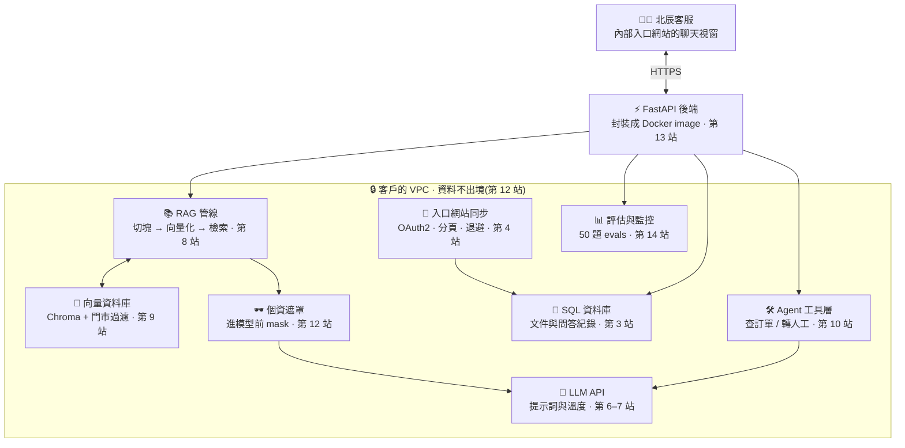
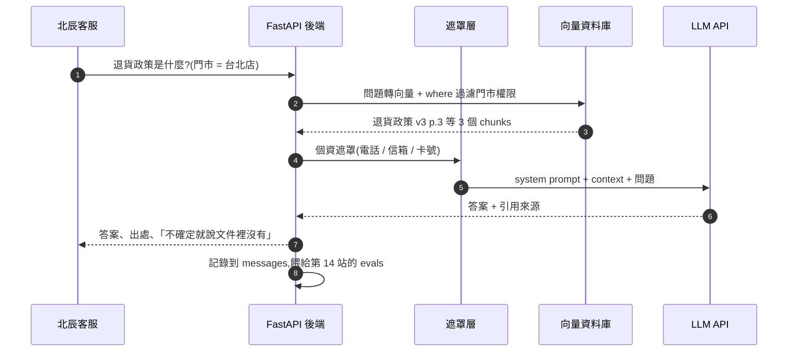

<div align="center">

# 🧭 FDE Roadmap 2026

**Forward Deployed Engineer · 15 站互動學習地圖:從第一行 Python,到交付一個客戶真的在用的 AI 系統。**

[🚀 線上開始](https://yu-0312.github.io/ai-engineer-roadmap/) ·
[🤝 畢業交付案](https://yu-0312.github.io/ai-engineer-roadmap/#/capstone) ·
[🐛 回報問題](https://github.com/Yu-0312/ai-engineer-roadmap/issues)

[](https://yu-0312.github.io/ai-engineer-roadmap/)
[](https://github.com/Yu-0312/ai-engineer-roadmap/actions/workflows/link-check.yml)


<a href="https://yu-0312.github.io/ai-engineer-roadmap/">
  
</a>

</div>

這不是 15 篇零散教學,而是一條有主線劇情的導入旅程。虛構客戶「**北辰零售集團**」:12 間門市、12 位第一線客服、300 份政策文件,專案從客服主管的一句「我們想要一個 AI 客服」開始。每一站都替這個案子交付一樣東西 — 一支同步腳本、三張資料表、一份訪談紀錄、一張資安說明白皮、一個 Docker image、一份 runbook。走完 15 站,你手上不是「學過 AI」,而是一件**能拿去面試的 FDE 案例**。

**純前端、零依賴、免建置。** 打開 `index.html` 就能用;學習進度只存在你的瀏覽器裡。

> Repo 名稱保留 `ai-engineer-roadmap`(讓既有網址與徽章繼續有效),內容與站點標題已全面對齊 **Forward Deployed Engineer** 這個因 AI 而新生的職位。

| 你的目標 | 從這裡開始 |
| --- | --- |
| 第一次來,想直接學 | [線上開始](https://yu-0312.github.io/ai-engineer-roadmap/#/stage/1) → 第 1 站 Python |
| 想知道 FDE 到底在做什麼 | [FDE 是什麼職位](#fde-是什麼職位) |
| 想看這門課最終交付什麼 | [北辰零售集團導入案](#北辰零售集團導入案) |
| 想改內容、加一站 | [內容資料格式](#內容資料格式) |

---

## FDE 是什麼職位

Forward Deployed Engineer(前置部署工程師)是 2020 年代因為大模型才成形的一個職位:你不是在自己辦公室寫一個通用產品,而是**進到客戶的現場**,把 LLM、客戶自己的資料和客戶既有的系統,組成一個有人每天在用的東西,然後把它交出去、讓它繼續跑。Palantir 最先把它做成一個職稱,現在 AI 公司與軟體廠商都在開這個缺 — 因為模型本身不難拿到,**難的是把它塞進一家公司的真實流程裡**。

這門課就是照著這個職位的實際工作流設計的。同一件事,FDE 和「會調 API 的人」做法不同:

| 傳統 AI 工程師 | Forward Deployed Engineer |
| --- | --- |
| 拿到一份規格書 | 去訪談,把「我們想要 AI 客服」問成一道可衡量的問題(第 11 站) |
| 用公司自己的資料 | 打通客戶的入口網站與資料庫,資料根本不在你手上(第 3、4 站) |
| 讓 demo 跑起來 | 讓它過資安審查:資料分級、個資遮罩、金鑰不落地(第 12 站) |
| 部署到自己的雲 | 裝進客戶的 VPC 或本地機房,資料不出境(第 13 站) |
| 上線就算結束 | 用 50 題 evals 證明有進步,壞例子歸因、持續迭代(第 14 站) |
| 不碰商務 | 寫 runbook、訓練超級用戶、算出回本周期,讓客戶續約(第 15 站) |

課程的五個章節,對應 FDE 的五組能力:

| 章 | 站 | 能力 | 建議時間 |
| --- | :--: | --- | --- |
| 第一章 · 工程基本功 | 1–4 | 寫得動程式、管得住版本、查得動資料、接得上客戶系統 | 6–8 週 |
| 第二章 · AI 原理 | 5–7 | 知道模型怎麼學會、怎麼運作、怎麼被你說服 | 6 週 |
| 第三章 · 應用搭建 | 8–10 | RAG、向量庫、Agent:把能力組合成一個會幹活的助理 | 5–7 週 |
| 第四章 · 客戶現場 | 11–13 | 訪談定義問題、資安合規與成本、部署進對方的環境 | 4–5 週 |
| 第五章 · 交付與迭代 | 14–15 | 用數字證明、把系統交出去、讓它離開你也能跑 | 3–4 週 |

合計約 **24–30 週**。每週抓 8–10 小時,全程約 6–7 個月。時長是站上標示的建議值,不是硬性期限。

## 路線圖

五章、15 站,每一站都以前一站為基礎;第四章開始回到「人」的那一半。

<p align="center">
  
</p>

## 15 站與北辰導入案

每一站的「動手實作」都會直接變成導入案的一項交付物。

| # | 站 | 你會帶走 | 交付給北辰 |
| :--: | --- | --- | --- |
| 01 | 🐍 Python | 變數、容器、函式、venv、檔案與 JSON | 讀 300 份文件、清文字、統計字詞的資料管線雛形 |
| 02 | 🔧 Git + GitHub | add/commit/push、分支、PR、`.gitignore` | 導入案 repo、README(客戶第一眼看到的說明書) |
| 03 | 🗄️ SQL + 資料庫 | 表設計、CRUD、JOIN、SQL vs NoSQL | `documents` / `chats` / `messages` 三張核心表與一張提問報表 |
| 04 | 🔌 REST API 與系統整合 | OAuth2、分頁、429 退避、webhook | 每天自動同步北辰入口網站文件的 `sync_portal_docs.py` |
| 05 | 📊 機器學習與深度學習速讀 | 監督式學習、過擬合、Tensor、訓練迴圈、Transformer | 分辨「退貨 / 保固 / 門市」的意圖分類器 |
| 06 | 🤖 LLM 基礎 | token、context window、temperature、API | DocMind 第一次對客服開口,以及每顆參數的代價 |
| 07 | ✍️ 提示詞工程 | 系統提示、few-shot、CoT、注入防護 | 定稿的 system prompt:角色、規則、格式、「一律附來源」 |
| 08 | 📚 RAG 檢索增強生成 | chunk、retrieval、citation、完整管線 | 上傳 → 切塊 → 檢索 → 有憑有據、附來源的回答 |
| 09 | 🧩 向量資料庫 + Embeddings | embedding、cosine、ANN、Chroma | 支援依門市/文件類型過濾的正式知識庫 |
| 10 | 🛠️ AI Agents | function calling、ReAct、MCP、迴圈上限 | 會查訂單與庫存、必要時轉真人的工具層 |
| 11 | 🎯 需求訪談與問題定義 | Mom Test、利害關係人地圖、MoSCoW、成功指標 | 《需求訪談紀錄》:問題陳述、不做的清單、一個指標 |
| 12 | 🔐 資安、合規與成本 | 資料分級、機密管理、去識別化、注入防護、成本結構 | 《資安與成本說明白皮》+ 個資遮罩模組 |
| 13 | 🚀 部署進客戶的環境 | Docker image/container、FastAPI、secrets 注入 | image + 服務 + 《部署需求單》(域名、持久卷、金鑰來源) |
| 14 | 📈 評估、監控與迭代 | 黃金測試集、分層評估、LLM-as-a-Judge、壞例子歸因 | 50 題 evals、監控面板與每次改動的數字 |
| 15 | 🤝 交付、教育訓練與 ROI | runbook、超級用戶、支援分軌與 SLA、採用率、回本周期 | 完整交付包:runbook + 教育訓練 + ROI 單頁 |

## 北辰零售集團導入案

15 站的積木,拼成這個跑在客戶環境裡的系統。



<details>
<summary>展開一次提問的完整流程(客服問「退貨政策是什麼?」)</summary>



</details>

### 四週導入時間軸

真實的導入案不會照課程章節順序發生。這是同一個案子在客戶現場的四週:

| 週期 | 現場在做什麼 | 對應站數 | 產出 |
| --- | --- | :--: | --- |
| 第 1 週 | 訪談三種角色、寫問題陳述、砍範圍 | 第 11 站 | `discovery-notes.md` |
| 第 1–2 週 | 打通文件來源、設計資料表、寫同步腳本 | 第 1–4 站 | 每天自動更新的知識庫來源 |
| 第 2–3 週 | 切塊、向量、檢索、提示詞、工具 | 第 5–10 站 | 會回答也會辦事的助理 |
| 第 3 週 | 資料分級、個資遮罩、成本試算、過資安審查 | 第 12 站 | 說明白皮 + 遮罩模組 |
| 第 4 週 | 打包進客戶 VPC、教育訓練、交接 | 第 13、15 站 | image + runbook + ROI |
| 上線後 | 黃金測試集、監控、壞例子歸因、迭代 | 第 14 站 | 每次改動的數字 |

### 交付包驗收清單

- [ ] 《需求訪談紀錄》:問題陳述、明確不做的清單、一個成功指標
- [ ] 文件自動同步進 `documents` 表,只同步有變動的部分
- [ ] 回答附上來源;資料不足時明確說「文件中沒有提到」
- [ ] 檢索依門市權限過濾,台北店查不到總公司的採購流程
- [ ] 至少三個工具:知識庫檢索、訂單查詢、轉人工,且迴圈有上限
- [ ] 進模型前遮罩個資;金鑰不在 code、不在 image、不在 Git 歷史裡
- [ ] 跑在客戶 VPC 的 Docker 服務,附《部署需求單》
- [ ] 50 題黃金測試集,每次改提示詞都重跑,壞例子有歸因
- [ ] runbook、超級用戶名單、支援分軌與 ROI 單頁
- [ ] 寫一篇「我如何把 DocMind 導入北辰」的技術文章

## 怎麼學

每一站的頁面都是同一個節奏:

1. **選一站** — 從路線圖點進去。
2. **讀「接續上一站」** — 知道這一站為什麼存在。
3. **看「本站要交付給北辰導入案的」** — 學的是交付物,不是名詞。
4. **翻概念卡** — 先建立直覺,再看程式碼。
5. **跑一次程式碼** — 複製、貼上、改一個參數。
6. **做 3 題測驗** — 答錯看解析,重新作答;15 站完成解鎖證書。

<details>
<summary>站點頁面預覽(第 11 站 需求訪談與問題定義)</summary>
<br>
<p align="center">
  
</p>
</details>

## FDE 面試會問什麼

走完 15 站,這些問題你應該都能用自己的專案回答:

| 面試會問 | 這門課在哪一站給你答案 |
| --- | :--: |
| 客戶只說「我們想要 AI」,你接下來的三天做什麼? | 11 |
| 資料在客戶的入口網站與內部系統,你怎麼拿到、怎麼保持同步? | 3、4 |
| RAG 檢索不到正確段落,你會怎麼排查? | 8、9、14 |
| 怎麼防止模型把客戶的個資或內部文件外洩? | 12 |
| 提示詞注入怎麼防? | 7、12 |
| API key 放在哪裡?為什麼不能放? | 12、13 |
| 客戶要求系統跑在他們的 VPC / 本地,你怎麼交付? | 13 |
| 上線後你要追蹤哪些指標? | 14 |
| 怎麼向 CXO 證明這個案子值得續約? | 15 |
| 你不在的時候,系統壞了誰修? | 15 |

## 功能

| | 功能 | 說明 |
| :--: | --- | --- |
| 🗺️ | 15 站主線 | 五章環環相扣,每站都有「接續上一站」與「下一站預告」 |
| 📝 | 45 道隨堂測驗 | 每站 3 題,作答後即時解析;全對才能標記完成 |
| 🧪 | 3 座互動實驗室 | 第 6 站 temperature 模擬器、第 7 站提示詞建構器、第 9 站語意空間地圖 |
| 💻 | 20 張程式碼卡 | 可複製範例、語法高亮、行內註解;Markdown 卡直接展示交付文件格式 |
| 📖 | 77 個概念卡 | 點擊翻牌看解釋,英文術語一併標出 |
| 📈 | 進度系統 | localStorage 保存、頂部進度環、路線圖勾勾、可一鍵重置 |
| 🏆 | 結業證書 | 完成 15 站解鎖,可輸入名字並列印或存成 PDF |
| 📴 | 離線可用 | 無 CDN、無 npm、無建置;`file://` 直接開也能跑 |

## 快速開始

**方式一:直接開檔(最快)**

用瀏覽器打開 `index.html` 即可。三個互動實驗室與測驗都不需要網路。

**方式二:本機伺服器**

```bash
git clone https://github.com/Yu-0312/ai-engineer-roadmap.git
cd ai-engineer-roadmap
python3 -m http.server 8000
# 打開 http://localhost:8000
```

不需要 `npm install`,也沒有 build step。網站本身零依賴;各站的 Python 範例則需要你自己的環境與 API key(第 6、8、9、10 站)。

## 專案結構

```text
ai-engineer-roadmap/
├── index.html              # 頁面骨架、meta、favicon
├── css/
│   └── style.css           # 淺色主題、RWD、列印樣式
├── js/
│   ├── stages-a.js         # 第 1–8 站內容
│   ├── stages-b.js         # 第 9–15 站內容
│   └── app.js              # 章節定義、hash router、測驗、進度、3 個實驗室、交付案
├── docs/
│   ├── roadmap.svg         # README 路線圖(五章 15 站)
│   ├── screenshot.png      # README 首頁預覽
│   └── stage-preview.png   # README 站點預覽
└── .github/
    └── workflows/
        └── link-check.yml  # 每月外部連結檢查
```

## 內容資料格式

每一站都是一個物件,放在 `js/stages-a.js`(1–8)或 `js/stages-b.js`(9–15)。最小結構如下:

```js
{
  id: 11,
  emoji: "🎯",
  title: "需求訪談與問題定義",
  tagline: "最貴的錯誤,是做出沒人想用的東西",
  duration: "約 1 週",
  color: "#dc2626",                        // 站標與進度條配色
  connection: "接續上一站…",                // 頁首「接續上一站」
  contribution: "交付《需求訪談紀錄》…",     // 頁首「本站要交付給北辰導入案的」
  goals: ["…"],
  concepts: [{ t: "問題陳述", en: "Problem Statement", d: "…" }],
  code: [{ lang: "markdown", name: "discovery-notes.md", desc: "…", src: "…" }],
  quiz: [{ q: "…", opts: ["A", "B", "C", "D"], a: 1, why: "…" }], // a 從 0 開始
  demo: null,                              // null / temperature / prompt / embeddings
  project: "…",
  resources: [{ n: "The Mom Test", u: "https://momtestbook.com/" }],
  next: "下一站預告…"
}
```

`lang` 支援 `python` / `bash` / `sql` / `dockerfile` 等語法高亮;`markdown` 與 `text` 走純文字,不額外上色。

### 加一站時要改的地方

1. 在 `stages-a.js` / `stages-b.js` 新增站點物件,`id` 接續編號,`next` 指向新站。
2. 更新 `app.js` 的 `CHAPTERS`,把新站放進對應章節的 `ids`。
3. 若要新增互動實驗室,同步補 `DEMO_NAMES`、`demoSkeleton()` 與對應的 `init*Demo()`。
4. 更新 `docs/roadmap.svg`、README 的站數與表格;進度環、首頁統計、交付案清單與證書門檻都會自動跟著 `STAGES.length` 計算。
5. 跑一次外部連結檢查(見下方)。

## 進度與隱私

- 進度存在 `localStorage` 的 `ai-roadmap-2026-progress-v1`,包含已完成站點、測驗通過狀態與證書名字。
- 沒有帳號、沒有後端,資料不會離開瀏覽器;換裝置或清除瀏覽器資料就會歸零。
- 右上角 `↺` 可重置全部進度。
- 結業證書是這趟學習旅程的里程碑,不是官方認證。

## 維護

外部連結放在 `.github/workflows/link-check.yml`,使用 [lychee](https://github.com/lycheeverse/lychee) 檢查 HTML、Markdown 與 JS 裡的 URL:

- PR 時自動執行
- 每月 1 號 03:17 UTC 排程執行
- 可在 Actions 頁面手動觸發
- 接受 `200–299`、`403`、`429`,其餘狀態視為失敗

本機重現:

```bash
lychee --no-progress --max-concurrency 4 \
  --accept 200..=299,403,429 \
  --exclude-loopback \
  './**/*.html' './**/*.md' './**/*.js'
```

> 目前 workflow 只綁 PR 與每月排程,直接 push 到 `main` 不會即時檢查;若想每次 push 都跑,可在 `on:` 加上 `push:`。

## 已知限制

- **純前端**:沒有帳號與後端,進度不會跨裝置同步。
- **內容會過期**:模型名稱、API 參數與外部連結都可能有變動;每月檢查連結,技術細節請以官方文件為準。
- **案例是虛構的**:「北辰零售集團」與文件內容為了教學而設計,ROI 與成本數字是示範用的假設值,不是任何真實客戶的資料。
- **範例需要自己的金鑰**:第 6、8、9、10 站的 Python 範例要安裝套件並設定 API key;網站本身不需要。
- **證書非認證**:它記錄的是你走完 15 站,不是任何機構的資格證明。

## 貢獻

錯字、事實錯誤、失效連結、更好的圖示都歡迎開 issue 或 PR。

- 內容請維持繁體中文,沿用既有的章節與站號。
- 新增站點時,請同時寫明「這一站交付給北辰什麼」,維持主線。
- 修改程式碼範例時,請附上實際執行環境與輸出。
- 送出 PR 前,請跑一次上面的連結檢查。

---

<p align="center">
  <sub>Made for learning · 內容整理自各站列出的文件與教學 · FDE Roadmap 2026</sub>
</p>
